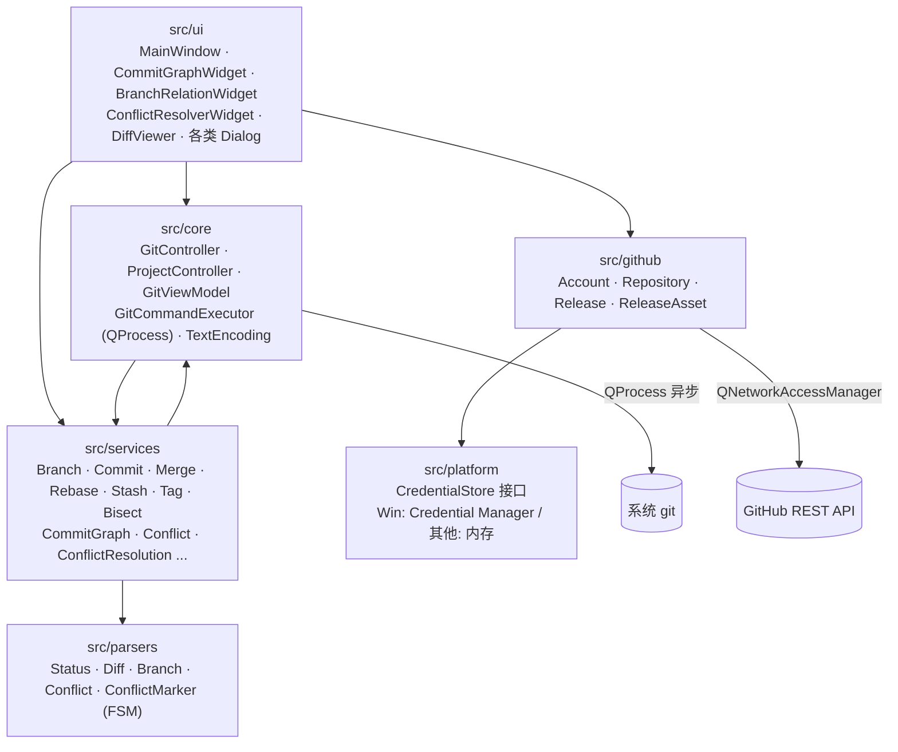
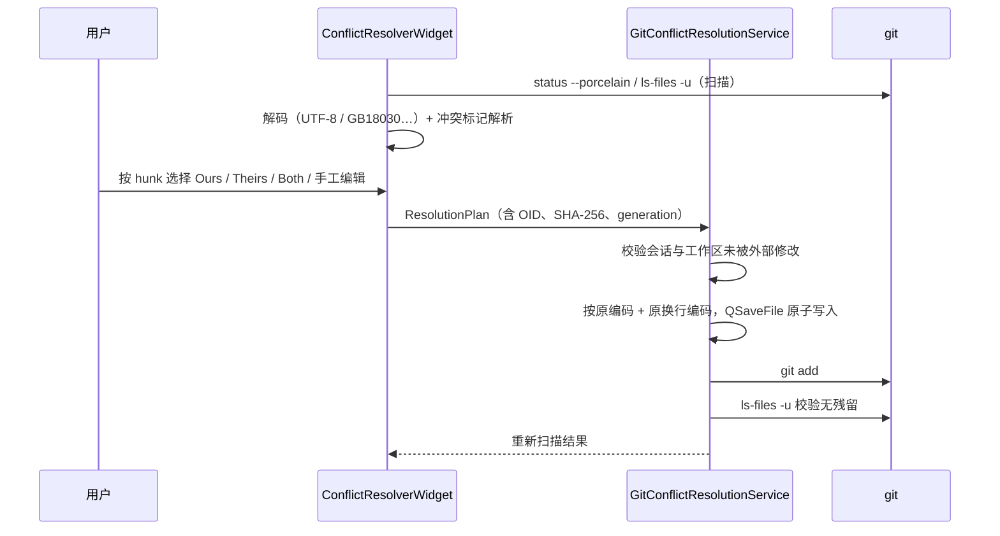

# QtGitStudio

[](https://github.com/Lin32014012/QtGitStudio/actions/workflows/ci.yml)

QtGitStudio 是一个基于 **C++17 / Qt 6 Widgets** 的 **Git 可视化桌面工具**。它通过 `QProcess` 异步调用系统里的 `git`，把提交图、分支关系、diff、stash、tag、bisect、Release 等常用操作做成图形界面。项目的重点是**合并冲突的可视化解析和分步应用**：扫描冲突 → 解析冲突标记 → 生成 ResolutionPlan → 原子写回 → stage 校验 → 重新扫描。

## 与 lazygit 的关系

本仓库是一个**独立实现的 Qt 客户端**，运行时只依赖系统安装的 `git`，**既不链接也不调用** [lazygit](https://github.com/jesseduffield/lazygit) 的 Go 代码或二进制。开发时参考过开源 TUI 客户端的交互思路，但请不要把本项目说成 lazygit 的 fork 或「Qt 版 lazygit」。

## 截图

> 截图和演示 GIF 还没有补上，计划补充以下三张：
> 1. 主界面（仓库状态 + 暂存区）
> 2. 提交图 / 分支关系图
> 3. 冲突解决界面（按 hunk 选择 Ours / Theirs / Both）

## 功能概览

- 打开 / 克隆仓库、分支树、提交图、分支关系图、diff 预览
- Merge / Rebase / Cherry-pick / Revert 过程中的冲突处理
- 冲突标记的有限状态解析（支持 diff3 的 `|||||||`），可以按 hunk 选择 Ours / Theirs / Both
- 乐观并发保护：写入前核对 index OID、工作区 SHA-256 和会话 generation，仓库被外部修改就拒绝写入
- 多编码文本：UTF-8、UTF-8 BOM、UTF-16（带 BOM）、**GB18030 / GBK**，写回时保持原编码和换行风格（见下文）
- 学习模式（LearningWidget），错误提示改写成用户能看懂的中文
- GitHub API（仓库 / Release），token 存放在系统凭据库
- 50 多个 Qt Test 测试，包括冲突 parser / service / resolver / workflow、竞态测试、压力测试和性能基准

## 架构



| 目录 | 内容 |
|---|---|
| `src/core` | 命令执行器、控制器、视图模型、仓库会话、编码检测 |
| `src/parsers` | `git status/diff/branch` 输出解析，冲突标记状态机 |
| `src/services` | 15 个 Git 领域服务，冲突模型与 ResolutionPlan |
| `src/github` | GitHub 账号、仓库、Release 服务 |
| `src/platform` | 凭据存储（编译期选择后端） |
| `src/ui` | 所有 Widget 和对话框 |
| `tests` | Qt Test 测试和 `test_perf_commit_graph` 性能基准 |

冲突解决的完整流程：



## 平台支持

| 平台 | 状态 | 凭据存储 |
|---|---|---|
| Windows（MinGW） | 主要开发平台，CI 构建并运行全部测试 | Windows Credential Manager（`CredWriteW`） |
| Linux（GCC） | CI 构建并运行全部测试 | 仅在内存中保存（**重启后需要重新登录**，token 不会写入磁盘） |
| macOS | 未测试，理论上和 Linux 走同一套代码 | 同 Linux |

凭据后端在**编译期**选择，都实现同一个 `CredentialStore` 接口，见 `src/platform/CredentialStoreFactory.cpp`。Windows 专有的测试在其他平台上会用 `QSKIP` 跳过，不会删掉。

## 编码支持

冲突文件和 diff 按以下顺序检测编码：

1. BOM：`EF BB BF` 判为 UTF-8 (BOM)，`FF FE` / `FE FF` 判为 UTF-16 LE / BE
2. 严格合法的 UTF-8（含纯 ASCII）判为 UTF-8
3. 能无错误地按 GB18030 解码，**并且**重新编码后与原字节完全一致，判为 GB18030（GBK / GB2312 是它的子集）
4. 以上都不满足，判为未知编码：**拒绝写回**，不会写文件，也不会 stage

写回时使用文件原来的编码，并保留 CRLF 和 BOM。GB18030 优先用 Qt 的 `QStringConverter`（Qt 带 ICU 编译时可用）；在没有 ICU 的 Windows 版 Qt 上，改用 Win32 代码页 54936。两者都不可用时，相关测试会跳过，这类文件按「未知编码」处理。

说明：UTF-16 文件会被 git 当成二进制文件，所以冲突界面会走二进制（选整份 Ours / Theirs）的流程。

## 环境要求

- Qt 6.8 或更高版本（Widgets / Network / Svg / Test）。CI 使用 Qt 6.8.3，本机开发使用 Qt 6.11
- CMake 3.22 或更高版本
- Ninja（或 MinGW Makefiles）
- Windows 用 MinGW g++ 13 及以上，Linux 用 GCC 12 及以上
- 系统已安装 `git`（2.31 或更高版本；测试依赖 `GIT_CONFIG_COUNT`）

## 构建

### Windows（MinGW）

```bash
cmake -S . -B build -G Ninja -DCMAKE_BUILD_TYPE=Release -DCMAKE_PREFIX_PATH=C:/Qt/6.11.1/mingw_64
cmake --build build
```

### Linux（Debian / Ubuntu）

```bash
sudo apt install cmake ninja-build g++ git qt6-base-dev qt6-svg-dev qt6-tools-dev libgl-dev
cmake -S . -B build -G Ninja -DCMAKE_BUILD_TYPE=Release
cmake --build build
./build/QtGitStudio
```

如果发行版自带的 Qt 版本太旧，可以用 [aqtinstall](https://github.com/miurahr/aqtinstall) 安装 Qt 6.8 以上版本，再通过 `-DCMAKE_PREFIX_PATH` 指定路径。

## 测试

```bash
# 常规测试（不含性能基准）
ctest --test-dir build --output-on-failure -LE perf
# 性能基准
ctest --test-dir build -L perf -V
```

`ctest` 会自动为每个测试设置 `QT_QPA_PLATFORM=offscreen` 和 `init.defaultBranch=main`，不依赖本机的 git 全局配置。在 Linux 的 SSH 或 CI 环境里也能无界面运行。

## 性能

提交图在 1k、5k、10k 个提交下的加载和布局耗时都是实测值，详见 [docs/PERFORMANCE.md](docs/PERFORMANCE.md)。在 10k 提交的仓库里：`git log` 加解析约 70 ms，默认视图（最近 60 条）约 2 ms，「查看全部」约 0.3–0.4 秒。耗时随提交数线性增长。

## 版本

版本号只在一个地方定义：`CMakeLists.txt` 里的 `project(QtGitStudio VERSION …)`。CMake 会把它作为 `QTGITSTUDIO_VERSION` 宏传给代码，程序里显示的版本（`MainWindow::version()`、`QApplication::applicationVersion()`）都来自这个宏。

## License

MIT，见 [LICENSE](LICENSE)。
